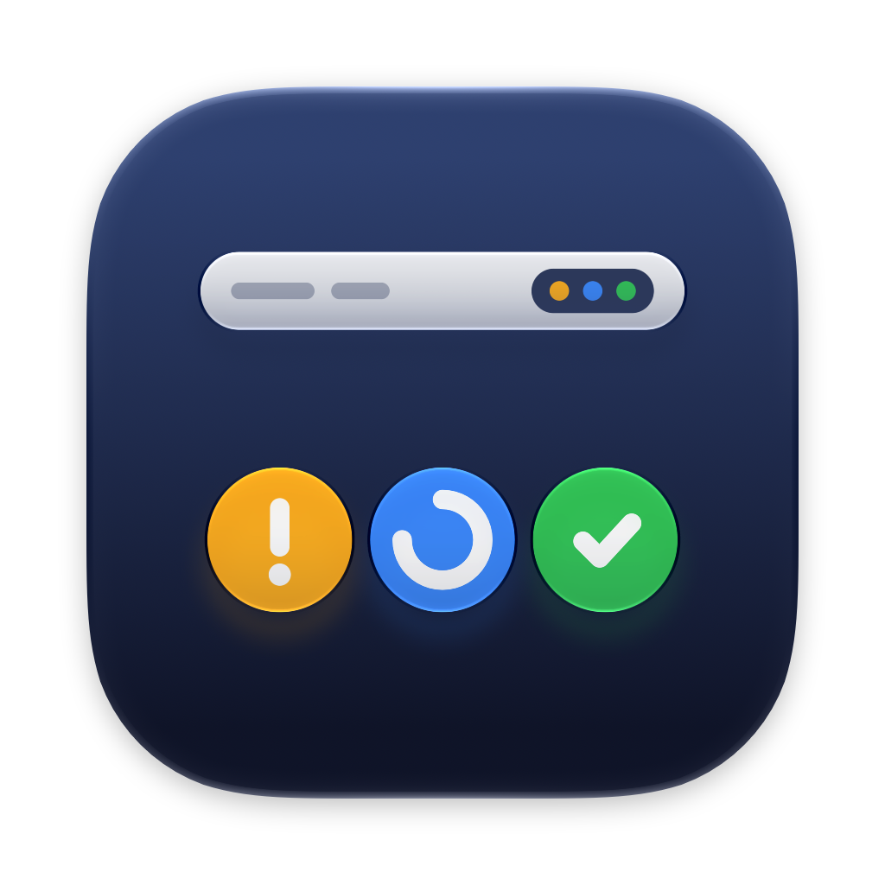
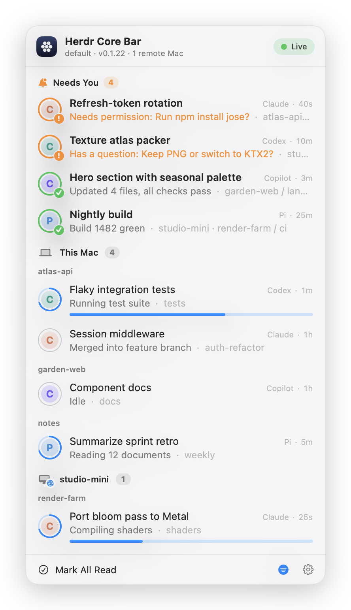
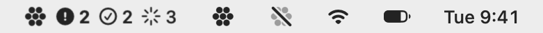
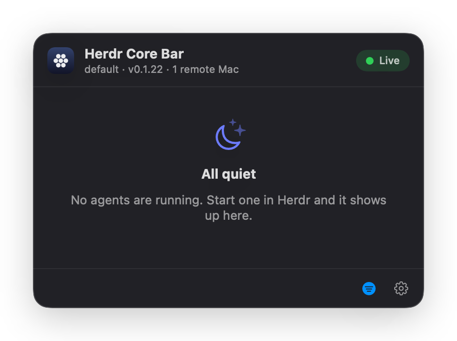
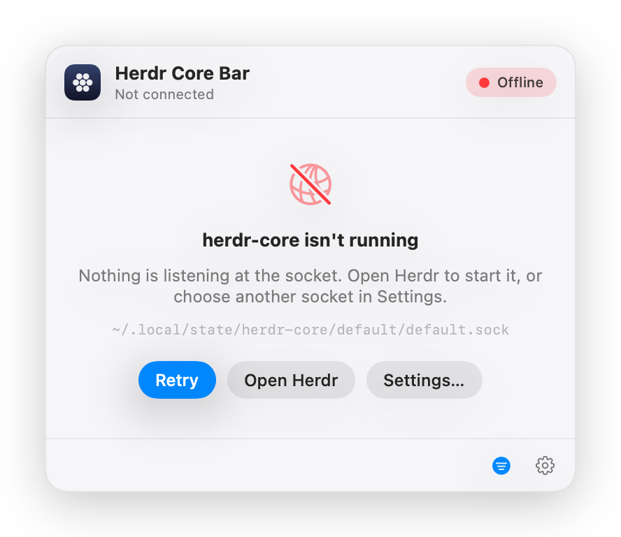
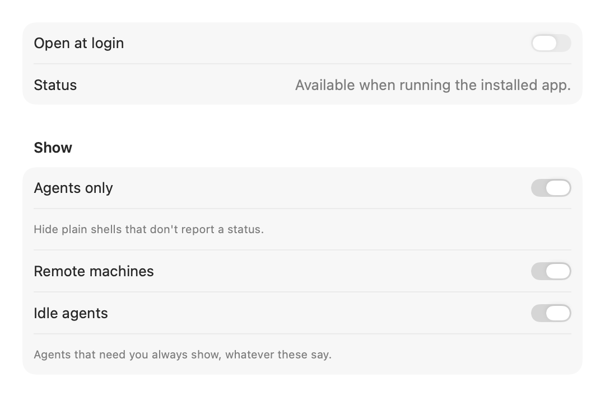
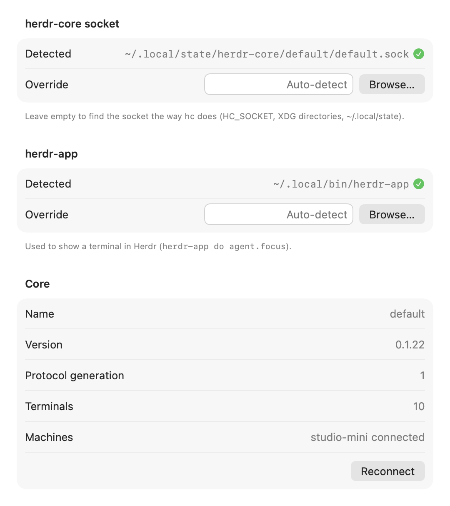
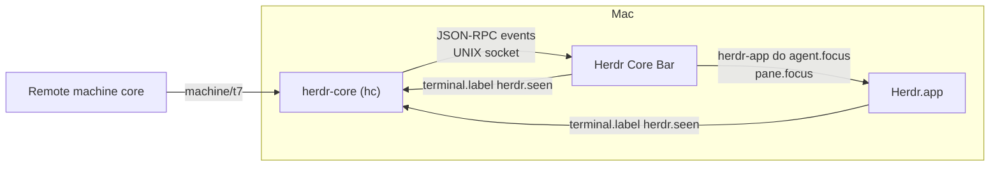

<p align="center">
  
</p>

<h1 align="center">Herdr Core Bar</h1>

<p align="center">
  <strong>Your coding agents at a glance, from the macOS menu bar.</strong><br>
  A native companion for <a href="https://herdr.dev">herdr-core</a> and Herdr.app.
</p>

<p align="center">
  <a href="https://github.com/olohmann/herdr-core-bar/releases/latest"></a>
  <a href="https://github.com/olohmann/herdr-core-bar/actions/workflows/ci.yml"></a>
  
  
  <a href="LICENSE"></a>
</p>

<p align="center">
  <picture>
    <source media="(prefers-color-scheme: dark)" srcset="docs/images/popover-dark.png">
    
  </picture>
</p>

Herdr Core Bar watches every terminal in herdr-core, on this Mac and on your remote machines.
The menu bar shows how many agents are **blocked**, **finished** or **working**. One click
takes you to the agent's pane in Herdr, with the keyboard already in its terminal.

<p align="center">
  <picture>
    <source media="(prefers-color-scheme: dark)" srcset="docs/images/menubar-dark.png">
    
  </picture>
</p>

## Contents

- [Features](#features)
- [Requirements](#requirements)
- [Install](#install)
- [Using it](#using-it)
- [Settings](#settings)
- [How it works](#how-it-works)
- [Privacy](#privacy)
- [Troubleshooting](#troubleshooting)
- [Building from source](#building-from-source)
- [Releasing](#releasing)
- [License](#license)

## Features

- **Live status, no polling.** It subscribes to herdr-core's ordered event stream. Changes
  show up the moment an agent reports them, and the app recovers on its own after the core
  restarts or the connection drops.
- **Counts in the menu bar.** Only nonzero groups are shown: needs you (`!`), finished but
  unread (`✓`) and working. When nothing needs you, it is just the icon.
- **Needs You first.** Blocked agents (permission, question, sign-in), errors and unread
  finished turns come first, sorted by urgency. The rest follow, grouped by machine and Herdr
  space, then tab.
- **One click to the agent.** Herdr opens with that agent's pane in front and keyboard focus
  in its terminal. Herdr is launched first if it isn't running.
- **Read state shared with Herdr.** Opening a finished agent marks it read everywhere. Herdr
  Core Bar uses the same `herdr.seen` marker that Herdr.app writes, so neither app shows a
  done agent you have already looked at.
- **Remote machines.** Terminals on machines added with `hc machine add` show up under their
  own heading.
- **Notifications that respect your attention.** You get a notification when an agent needs
  you or finishes a turn, with **Open** and **Mark as Read** actions. They wait briefly and
  are skipped if you already looked at the agent in Herdr.
- **Native and light.** SwiftUI and Liquid Glass on macOS 27, SF Symbols animations, full
  keyboard control, VoiceOver labels, and support for Reduce Motion, light and dark mode.
- **Starts at login and stays current.** A launch-at-login switch, and Sparkle updates that
  are EdDSA-signed and notarized.

## Requirements

- macOS 27 or later, on Apple silicon
- [herdr-core](https://herdr.dev) (`hc`) 0.1.22 or later, running locally
- [Herdr.app](https://herdr.dev) to open agents. The status display works without it.

## Install

### Homebrew

```sh
brew install --cask olohmann/tap/herdr-core-bar
```

### Disk image

Download `HerdrCoreBar-<version>.dmg` from the
[latest release](https://github.com/olohmann/herdr-core-bar/releases/latest), open it and
drag **Herdr Core Bar** to **Applications**. Every release is signed with a Developer ID and
notarized by Apple.

### From source

See [Building from source](#building-from-source).

## Using it

Click the menu bar item to open the popover.

| Action | How |
| --- | --- |
| Open an agent in Herdr | Click its row, or select it and press <kbd>Return</kbd> |
| Move the selection | <kbd>↑</kbd> / <kbd>↓</kbd> |
| Close the popover | <kbd>Esc</kbd> |
| Reconnect to herdr-core | <kbd>⌘</kbd> <kbd>R</kbd> |
| Settings | <kbd>⌘</kbd> <kbd>,</kbd> or the gear menu |
| Mark all finished agents as read | **Mark All Read** in the footer |
| Show plain shells too | The filter button in the footer |
| More actions | Right-click a row: **Open in Herdr**, **Mark as Read**, **Copy Address**, **Copy Working Directory**, **Reveal in Finder** |

### Status

| Status | Meaning |
| --- | --- |
| **Needs you** (amber `!`) | The agent waits for a permission, an answer or a sign-in |
| **Error** | The agent reported an error |
| **Finished** (green `✓`) | The agent finished a turn you haven't looked at yet |
| **Working** (blue ring) | The agent is working, with a progress bar when it reports progress |
| **Idle** | The agent is waiting for its next task |

<table>
  <tr>
    <td></td>
    <td></td>
  </tr>
  <tr>
    <td align="center">Nothing needs you</td>
    <td align="center">herdr-core isn't reachable</td>
  </tr>
</table>

## Settings

Open **Settings…** from the gear menu.

| Tab | Options |
| --- | --- |
| **General** | Launch at login, Agents only (hide plain shells), Remote machines, Idle agents |
| **Notifications** | When an agent needs you, when an agent finishes a turn, play sound, send a test notification |
| **Connection** | herdr-core socket (auto-detected or set by hand), `herdr-app` path, core name, version and machines, Reconnect |
| **Updates** | Automatic checks, Check Now, time of the last check |
| **About** | Version, license and links |

<p align="center">
  
  
</p>

## How it works



1. **Connect.** The app finds the herdr-core socket the same way `hc` does: `HC_SOCKET`,
   `$XDG_RUNTIME_DIR/herdr-core/<session>.sock`, then
   `~/.local/state/herdr-core/<session>/<session>.sock`. You can also set a path in Settings.
   It then sends `hello` with protocol generation 1.
2. **Subscribe.** `events.subscribe` returns a snapshot of every terminal, including remote
   ones such as `machine/t7`. After that come ordered events: created, status, turn, title,
   labels, finished, removed and more. Each carries a sequence number, so the app drops stale
   events. When the core reports `missed`, the app replaces its state with a fresh snapshot.
3. **Watch the connection.** The core sends a heartbeat every 15 seconds. If 40 seconds pass
   without one, the app reconnects with exponential backoff, from 1 up to 30 seconds.
4. **Decide what needs you.** A terminal is an agent once it reports a status through OSC 7501.
   A finished agent counts as unread while `turn` is greater than its `herdr.seen` label.
5. **Open.** Herdr Core Bar activates Herdr, runs `herdr-app do agent.focus` and
   `pane.focus`, then writes `herdr.seen = turn` so Herdr.app agrees.

The protocol details are in [docs/protocol.md](docs/protocol.md).

## Privacy

Herdr Core Bar talks only to your local herdr-core socket and runs the local `herdr-app` tool.
It has no analytics and no telemetry. The only network request is Sparkle's update check
against this repository's GitHub releases, and you can turn it off under
**Settings → Updates**.

## Troubleshooting

<details>
<summary><strong>The popover says "Offline"</strong></summary>

- Check that the core runs: `hc server status`.
- Apps started from Finder or at login don't see your shell's environment. If you use a
  custom `HC_SESSION`, `HC_SOCKET` or XDG directory, set the socket under
  **Settings → Connection**. To find the path, list the `herdr-core` folders:
  `ls ~/.local/state/herdr-core/*/` or `ls "$XDG_RUNTIME_DIR/herdr-core/"`.
- Press <kbd>⌘</kbd> <kbd>R</kbd> to reconnect now.
</details>

<details>
<summary><strong>Clicking an agent does nothing, or shows an error</strong></summary>

- Herdr Core Bar needs the `herdr-app` command-line tool, which Herdr.app installs to
  `~/.local/bin/herdr-app`. **Settings → Connection** shows the path it found, and you can
  choose another one.
- Terminals that Herdr.app doesn't display, such as background workers without a
  `herdr.space` label, can't be opened in Herdr.
</details>

<details>
<summary><strong>I don't get notifications</strong></summary>

Open **Settings → Notifications**. If permission was denied, **Open Notification Settings…**
takes you to System Settings. **Send Test Notification** checks delivery.
</details>

<details>
<summary><strong>An agent I already read shows up as finished</strong></summary>

Read state comes from the `herdr.seen` label on the terminal. Opening the agent in Herdr or
from the bar updates it. **Mark All Read** clears every finished agent at once.
</details>

<details>
<summary><strong>Logs</strong></summary>

```sh
log stream --predicate 'subsystem == "com.olohmann.herdr-core-bar"' --level info
```
</details>

## Building from source

You need Xcode 27 (Swift 6.4) on macOS 27.

```sh
git clone https://github.com/olohmann/herdr-core-bar.git
cd herdr-core-bar
scripts/build.sh --open                # builds, ad-hoc signs and launches dist/Herdr Core Bar.app
swift test                             # Swift Testing suites
swift-format lint --strict -r Sources Tests
```

| Path | Contents |
| --- | --- |
| `Sources/HerdrCoreKit` | The UI-free protocol library: JSON-RPC over a UNIX socket, models, the event reducer, presentation, notification policy and the reconnecting session |
| `Sources/HerdrCoreBar` | The SwiftUI app: menu bar label, popover, settings, notifications, Herdr focus, Sparkle |
| `Tests/` | Unit tests for both, including an in-process socket server |
| `scripts/` | `build.sh`, `verify-bundle.sh`, `release.sh`, `make-dmg.sh`, `update-cask.sh`, `test-release.sh` |
| `Resources/` | `Info.plist` and the Icon Composer app icon |

Developer conveniences:

- `HerdrCoreBar --preview` runs the app with invented sample data.
- `HerdrCoreBar --render-preview <dir>` writes the README screenshots to `<dir>`.
- `HCBAR_SCRATCH_SOCKET=<socket> swift test` adds an integration test against an isolated
  core, for example `HC_SESSION=scratch hc server start`.

## Releasing

Releases are cut by `scripts/release.sh`, either locally or from GitHub Actions when a
`v*` tag is pushed. The script:

- builds and signs with the Developer ID;
- notarizes and staples the zip and the DMG;
- signs the Sparkle appcast;
- publishes the GitHub release;
- updates the Homebrew cask.

Setup and steps are in [docs/releasing.md](docs/releasing.md). Changes are listed in the
[changelog](CHANGELOG.md).

## License

[MIT](LICENSE) © 2026 Oliver Lohmann.

Herdr Core Bar is an independent project and is not affiliated with Herdr.
